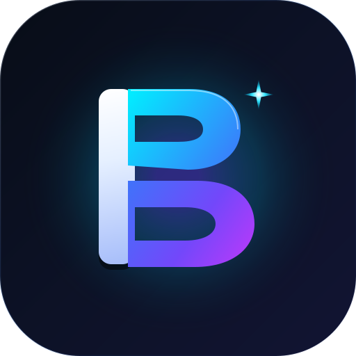
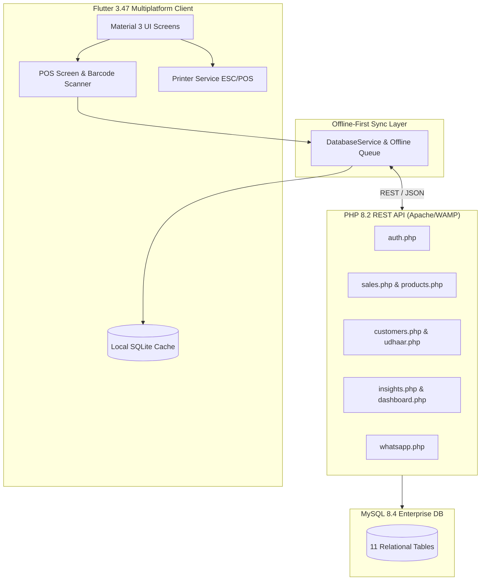

# BizPilot AI — Autonomous Smart Business Operating System

<div align="center">
  
  <br/>
  <h3>Next-Gen Offline-First Smart Business Manager, POS & Khata Operating System</h3>

  [](https://flutter.dev)
  [](https://dart.dev)
  [](https://php.net)
  [](https://mysql.com)
  [](https://android.com)
  [](LICENSE)
</div>

---

## 🌟 Overview

**BizPilot AI** is an enterprise-grade, offline-first smart business manager and POS system designed for small and medium businesses, retail stores, wholesale distributors, and grocery marts.

Engineered with a **PHP 8.2 & MySQL REST API** backend and a **Flutter 3.47 Material 3** multiplatform frontend, BizPilot AI bridges traditional Pakistani retail business workflows (like Udhaar / Khata recovery and Urdu WhatsApp notices) with modern AI-assisted retail intelligence.

---

## ⚡ Core Features

### 1. 🛒 POS & High-Speed Checkout
- Fast item lookup by name, category, or barcode.
- Quick cart modifications, quantity step counters, unit price overrides, and global discount calculations.
- Split payment modes: **Cash**, **Card**, or **Customer Udhaar (Credit)**.
- Integrated **Bluetooth & Wireless Thermal Receipt Printing** (58mm and 80mm ESC/POS roll formats with dynamic QR codes).

### 2. 📷 Live Camera Barcode & QR Code Scanner
- High-speed camera viewfinder powered by `mobile_scanner`.
- Supports EAN-13, EAN-8, UPC-A, Code-128, QR Codes, and 2D barcodes.
- Instant product lookup in POS and 1-tap barcode assignment during inventory restocking.
- Integrated flashlight / torch toggle and front/back camera switching.

### 3. 📒 Customer Udhaar (Khata) & Digital Recovery
- Complete ledger management with credit limits, customer balances, and transaction histories.
- Automated balance updates on Udhaar sales and repayment entries.
- **1-Tap WhatsApp Recovery**: Direct bilingual (Urdu & English) payment reminders with personalized customer balance, store contact, and payment urgency.

### 4. 📦 Inventory & Stock Control
- Real-time stock decrement on sales.
- Automated low-stock indicators and reorder thresholds.
- Cost vs. Selling price tracking with margin calculation.
- Search and filter by category, SKU, and stock availability.

### 5. 🧠 AI Business Intelligence Engine
- Algorithmic analysis of daily sales velocity and top-performing products.
- Dead stock detection and inventory holding cost analysis.
- Smart reorder recommendations based on demand patterns.
- Executive actionable summaries in bilingual Urdu/English text.

### 6. 📱 Google Play Store Release Kit
- Production-ready signed APK and Android App Bundle (`.aab`) pipeline.
- 1024x500 Feature Graphic & 512x512 Master Store Icon.
- Verified Google Play listing metadata (`APP_TITLE.txt`, `SHORT_DESCRIPTION.txt`, `FULL_DESCRIPTION.md`).
- Compliant Privacy Policy (`privacy_policy.html`) and Google Data Safety disclosures.

---

## 🏗️ Architecture



---

## 📁 Repository Structure

```
BizPilotAI/
├── backend/                              # PHP 8.2 REST API & Database Layer
│   ├── config/
│   │   └── database.php                  # PDO singleton with UTF-8 & error handling
│   ├── migrations/
│   │   └── 001_create_tables.sql         # 11 Relational InnoDB tables
│   ├── api/                              # REST API Endpoints
│   │   ├── auth.php                      # Business authentication
│   │   ├── dashboard.php                 # Real-time metrics & financial summaries
│   │   ├── products.php                  # Inventory CRUD & barcode search
│   │   ├── sales.php                     # POS transaction execution
│   │   ├── customers.php                 # Customer profiles & credit limits
│   │   ├── customer_ledger.php           # Statement of accounts
│   │   ├── udhaar.php                    # Udhaar balances & repayment records
│   │   ├── insights.php                  # AI analytics & recommendation engine
│   │   └── whatsapp.php                  # Bilingual WhatsApp reminder generator
│   ├── seed.php                          # Realistic Pakistani retail demo seeder
│   └── test_api.php                      # Comprehensive automated test suite (38/38 Passing)
│
├── bizpilot_app/                         # Flutter Multiplatform Client
│   ├── lib/
│   │   ├── models/                       # Product, Sale, Customer, UdhaarEntry, AiInsight
│   │   ├── services/                     # ApiService, DatabaseService, PrinterService, WhatsAppService
│   │   ├── widgets/                      # CameraBarcodeScanner, MetricCard, POS components
│   │   ├── theme/                        # Material 3 slate/indigo high-contrast theme
│   │   ├── screens/                      # Dashboard, POS, Inventory, Khata, AI Insights, Settings
│   │   └── main.dart                     # Navigation shell & entrypoint
│   ├── test/                             # Flutter unit & widget tests (15/15 Passing)
│   └── android/                          # Native Android platform config & launcher mipmaps
│
├── playstore_release_kit/                # Complete Google Play Store Publishing Kit
│   ├── graphics/                         # 1024x500 Feature graphic & 512x512 store icons
│   ├── listing_text/                     # App titles, short/full descriptions, keywords
│   ├── privacy_policy.html               # Public privacy policy
│   ├── DATA_SAFETY_ANSWERS.md            # Play Console Data Safety questionnaire answers
│   └── DEPLOYMENT_GUIDE_URDU_ENGLISH.md  # Step-by-step release guide
│
├── app_icon_512.png                      # Master 512x512 High-Res App Icon
├── logo.svg                              # Scalable Vector Emblem
└── README.md
```

---

## 🚀 Quick Start Guide

### 1. Prerequisites
- **WampServer** (Apache 2.4+, MySQL 8.0+, PHP 8.2+)
- **Flutter SDK** 3.47+ & **Dart** 3.13+
- **Android Studio** / VS Code with Flutter extension
- Connected Android Device or Emulator

### 2. Backend Initialization
1. Ensure WampServer is running (Green tray icon).
2. Create database and seed demo data:
   ```bash
   php backend/seed.php
   ```
3. Run the automated integration test suite:
   ```bash
   php backend/test_api.php
   ```
   *Expected output: `38/38 assertions PASSED (100%)`*

### 3. Flutter App Launch
```bash
cd bizpilot_app
flutter pub get
```

#### For Android Physical Device:
When running on a physical Android device connected over USB, forward the backend port:
```bash
adb reverse tcp:8080 tcp:80
flutter run -d <device_id>
```

#### For Chrome Web:
```bash
flutter run -d chrome
```

---

## 🧪 Testing & Code Quality

- **Backend Integration Tests:** `php backend/test_api.php` — **38/38 PASSED (100%)**
- **Flutter Tests:** `flutter test` — **15/15 PASSED (100%)**
- **Static Analysis:** `dart analyze lib test` — **0 errors, 0 warnings**

---

## 📄 License
This project is licensed under the MIT License — see the [LICENSE](LICENSE) file for details.
